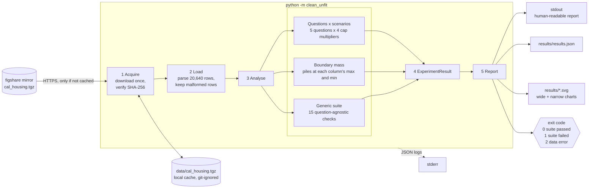
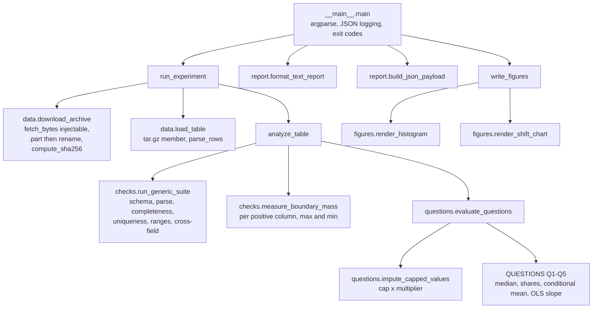
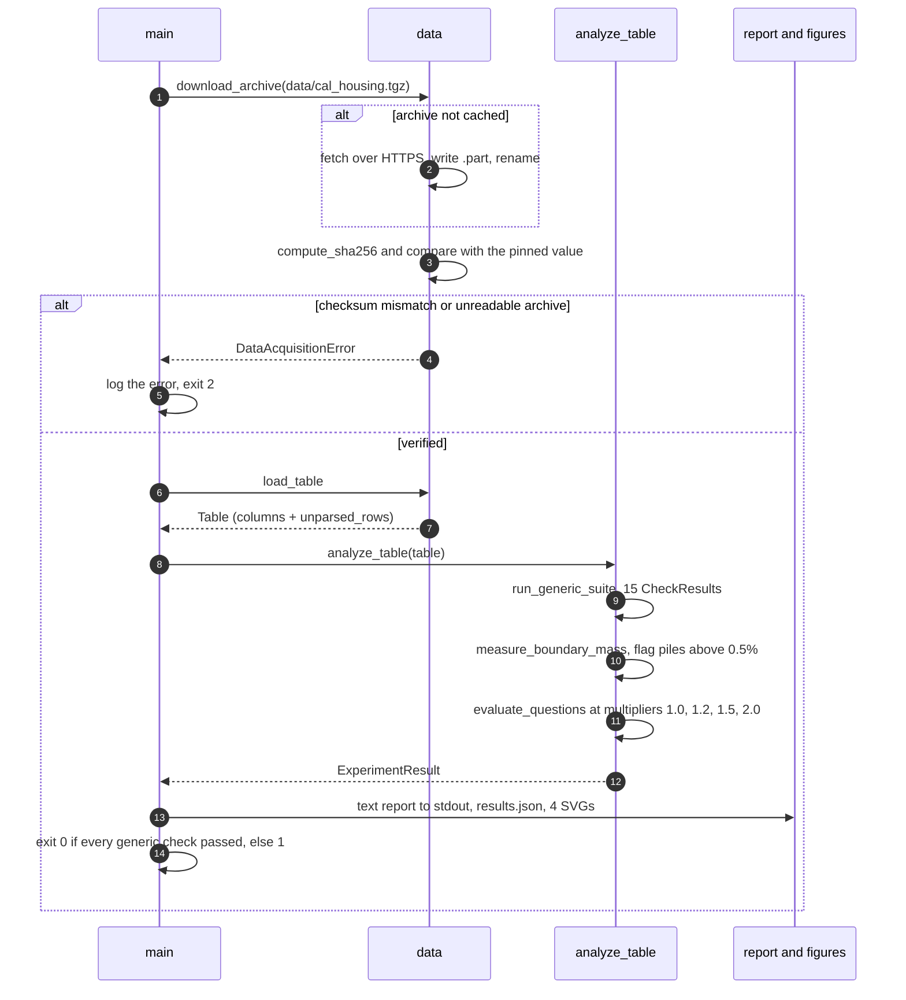
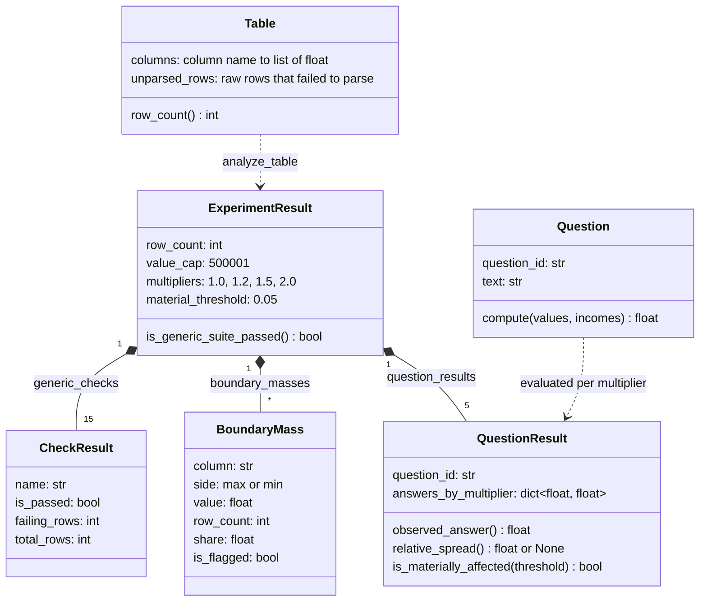
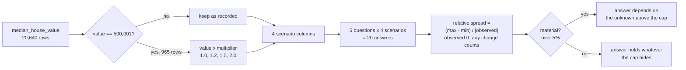

# clean-but-unfit

A small, reproducible experiment. It asks whether a dataset can pass question-agnostic quality checks and still be unable to answer some reasonable questions.

Article: [A Dataset Can Be Clean and Still Be Wrong for Your Question](https://renjithak-swe.github.io/writing/clean-but-wrong-for-your-question/)

## Claim and hypotheses

- **H1.** A generic quality suite reports no failures on the California Housing dataset. The suite checks schema, parsing, completeness, uniqueness, ranges and cross-field consistency.
- **H2.** Q1 and Q2 do not change across assumptions about the values hidden behind the house-value cap at $500,001. Q3, Q4 and Q5 change materially, meaning more than 5% relative.

| ID | Question |
|---|---|
| Q1 | Median of district median house values |
| Q2 | Share of districts with median value ≥ $400k |
| Q3 | Share of districts with median value ≥ $600k |
| Q4 | Mean median value in districts with median income ≥ $80k |
| Q5 | OLS slope of median house value on median income |

**What would weaken the claim:** if Q4 and Q5 barely move, the cap does not matter in practice for those questions.

## Data

California Housing (Pace & Barry, 1997): 1990 U.S. Census block groups, 20,640 rows, 9 numeric columns.

- **Download:** the program downloads the archive from the figshare mirror that scikit-learn uses (`https://ndownloader.figshare.com/files/5976036`). It then verifies SHA-256 `aaa5c9a6…ea681` before use.
- **Not redistributed:** the data is not included in this repo. `data/` is git-ignored.

Values at the cap are **not** imputed as truth. Each question is evaluated under explicit scenarios where every capped value is `cap × multiplier`, for multipliers 1.0, 1.2, 1.5 and 2.0. These are sensitivity assumptions, not estimates.

## Run

The code uses the Python standard library only and was tested on Python 3.13.2. It needs 3.10+ for `statistics.linear_regression` and modern type syntax. It is deterministic, so no random seeds are involved.

```bash
python -m unittest discover -s tests -t .   # 52 tests
python -m clean_unfit --data-dir data --out results
```

- **stdout:** the human-readable report.
- **stderr:** JSON-structured logs.
- **`results/results.json`:** full machine-readable results.
- **`results/house-value-histogram.svg`** and **`results/answer-shifts.svg`:** the article's two charts, rendered from the data.

**Exit codes:**

| Code | Meaning |
|---|---|
| 0 | Generic suite passed |
| 1 | Generic suite failed (the "clean" premise does not fully hold) |
| 2 | Data acquisition error |

## Architecture

### High-level design

A single command-line run. It downloads one public archive, checks the file against a pinned checksum, and runs three independent analyses on the same table. It writes a report, JSON results and charts, and its exit code says whether the "clean" premise held.



| Concern | How it is handled |
|---|---|
| Dependencies | Python standard library only, including SVG charts drawn without a plotting library. Nothing to install. |
| Data integrity | The archive is pinned by SHA-256. A mismatch stops the run with exit code 2, instead of analysing different data. |
| Partial downloads | The download is written to `.part` and renamed only when complete, so an interrupted download never looks finished. |
| Determinism | No randomness. The same archive always gives the same `results.json`. |
| Honest failure | Malformed rows are kept in `unparsed_rows`, not dropped. If the "clean" premise fails, the exit code says so (1) and the report still prints. |

### Low-level design: components

The modules form a straight pipeline. The download function is injected, so tests run offline against fixtures. The three analyses don't depend on each other.



### Low-level design: one run



### Low-level design: data model and scenario logic

The capped values aren't guessed. Each question is answered once per explicit assumption about what the cap hides, and the spread across those answers is the result.





### Design decisions

| Decision | Why | Rejected alternative |
|---|---|---|
| Sensitivity scenarios instead of imputing a "true" value | Values above the cap are unknown, so any single imputation would be a guess presented as data | Fitting a distribution to the tail, which adds an untestable assumption |
| The generic suite is question-agnostic on purpose | The experiment tests what such suites can miss, so the suite must not know the questions | Tuning the checks to the five questions |
| Exit code 1 when the "clean" premise fails | The headline claim depends on it, so a failure must be visible to scripts and CI, not just in the text | Always exiting 0 and leaving the result to be read |
| Malformed rows are kept, not dropped | Silently dropping rows would make the data look cleaner than it is | Skipping rows that don't parse |
| Pinned SHA-256 plus `.part` then rename | The analysis must run on exactly the archive that was published | Trusting the download URL |
| Standard library only, with hand-written SVG | Anyone can run it without installing anything, and charts render the same everywhere | numpy, pandas and matplotlib for about 900 lines of logic |
| The download function is injected | Tests run offline and deterministically | Mocking the network globally |

## Results (actual run, 2026-11-24)

**H1: not fully supported.** 14 of 15 generic checks passed. `households <= population` failed on 3 of 20,640 rows. Those rows are real anomalies, for example 4 households recorded for 3 people. None of them is a capped row.

**Boundary-mass check.** It flagged `median_house_value` (965 rows, 4.68%, at 500,001) and `housing_median_age` (1,273 rows, 6.17%, at 52). It did **not** flag `median_income` at 15.0001: those 49 rows (0.24%) fall below the 0.5% threshold.

**H2: supported.**

| Question | ×1.0 | ×1.2 | ×1.5 | ×2.0 | Relative spread |
|---|---|---|---|---|---|
| Q1 median value | 179,700 | 179,700 | 179,700 | 179,700 | 0% |
| Q2 share ≥ $400k | 8.58% | 8.58% | 8.58% | 8.58% | 0% |
| Q3 share ≥ $600k | 0.00% | 4.68% | 4.68% | 4.68% | undefined (observed answer is 0) |
| Q4 mean value, income ≥ $80k | 460,371 | 524,191 | 619,922 | 779,474 | 69.3% |
| Q5 slope per +$10k income | 41,794 | 46,917 | 54,601 | 67,407 | 61.3% |

Of the 691 districts with median income ≥ $80k, 441 (63.8%) are at the cap. That is why Q4 moves so much.

## Limitations

- **The multipliers are assumptions.** The true values above the cap are unknown, so the table shows how sensitive each answer is, not how wrong it is.
- **The boundary-mass threshold (0.5%) is a heuristic.** It missed the 49-row income pile-up. A different threshold would flag different columns.
- **The "generic suite" is one reasonable suite, not a standard.** Other suites could include other checks.
- **One dataset.** The result shows the mechanism exists. It does not show how common it is.

## Layout

| Path | Contents |
|---|---|
| `clean_unfit/data.py` | Download, checksum, parse (malformed rows are kept, not dropped) |
| `clean_unfit/checks.py` | Generic suite and boundary-mass check |
| `clean_unfit/questions.py` | Questions and scenario evaluation |
| `clean_unfit/report.py` | Text report and JSON payload |
| `clean_unfit/figures.py` | SVG charts, no plotting dependency |
| `clean_unfit/__main__.py` | CLI, structured logging, exit codes |
| `tests/` | Unit and integration tests (`unittest`) |

## License

- **Code:** MIT, see [LICENSE](LICENSE).
- **Data:** not redistributed. Cite Pace & Barry (1997) when using it.
